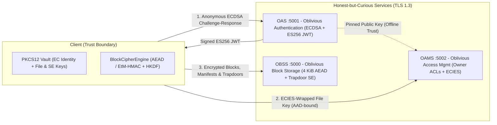
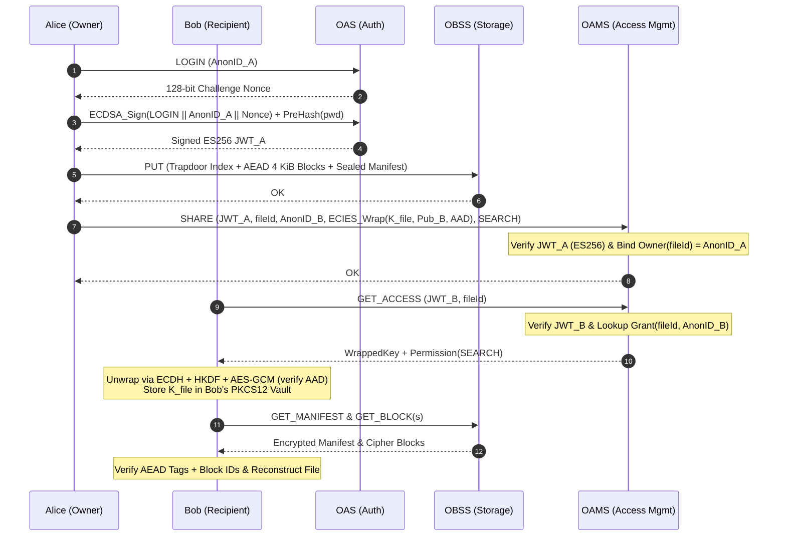

# Searchable Encrypted Block Storage & Oblivious IAM

[](https://github.com/CiscosProgramming/searchable-encrypted-block-storage-oblivious-iam/actions/workflows/ci.yml)

An end-to-end encrypted, searchable block-storage platform (**OBSS**) integrated with a decentralized **Oblivious Identity & Access Management** architecture (**OAS** + **OAMS**) built purely on standard Java Cryptography Architecture (`JCA`/`JCE`) and `JSSE` **TLS 1.3** primitives with **zero external runtime dependencies**.

Designed under an **honest-but-curious** and **active-tampering** server threat model: backend services authenticate anonymous ECC public-key identities, enforce stateless `ES256` JWT access policies, execute trapdoor conjunctive keyword searches, and distribute ECIES-wrapped file keys **without ever learning user identities, plaintext passwords, file contents, filenames, keywords, or symmetric keys**.

---

## System Architecture

The platform enforces strict separation of privilege across three independent TLS 1.3 services that share **no runtime database** and **no inter-service network calls**:



| Component | Role | What the Server Sees | What Remains Hidden (Client-Only) |
| :--- | :--- | :--- | :--- |
| **OAS** (`io.oblivious.oas`) | Anonymous registration, ECDSA challenge–response login, credential rotation & deletion, `ES256` JWT issuance | P-256 public keys (`AnonID`), salted+peppered PBKDF2 verifiers | Real user identities/aliases, raw passwords, private keys |
| **OAMS** (`io.oblivious.oams`) | Stateless JWT verification, owner-bound ACLs, ECIES wrapped-key distribution (`READ` / `SEARCH`), revocation | `AnonID`s, opaque `fileId`s, ECIES ciphertexts | Unwrapped file keys, file contents, plaintext metadata |
| **OBSS** (`io.oblivious.obss`) | Chunked encrypted block storage, keyed deduplication, encrypted manifests, conjunctive trapdoor search | Opaque cipher blocks, keyed HMAC block IDs, HMAC keyword trapdoors | Plaintext blocks, block order, keywords, search queries |

---

## Cryptographic & Security Design

### 1. Cryptographic Primitives Summary

| Capability | Primitive / Standard | Security Rationale |
| :--- | :--- | :--- |
| **Transport Security** | `TLSv1.3` (`TLS_AES_256_GCM_SHA384`, `TLS_CHACHA20_POLY1305_SHA256`) + X.509v3 SAN Hostname Verification | Protects all client–server frames in transit with forward secrecy and server pinning |
| **Block Cipher Modes** *(runtime-configurable)* | `AES-256-GCM` (96-bit IV, 128-bit tag)<br/>`ChaCha20-Poly1305` (96-bit nonce, 128-bit tag)<br/>`AES-256-CBC` + **Encrypt-then-MAC** `HMAC-SHA256` | Authenticated encryption; CBC mode verifies `HMAC-SHA256` via `MessageDigest.isEqual` *before* decryption to eliminate padding-oracle attacks |
| **Subkey Derivation** | RFC 5869 `HKDF-SHA256` | Derives domain-separated encryption, MAC, and deduplication subkeys from each 256-bit per-file root key, allowing seamless multi-cipher sharing |
| **Block & Manifest Binding** | AEAD / EtM-HMAC `AAD = (modeId, blockId)` / `(modeId, fileId)` | Prevents a malicious storage server from swapping blocks within/across files or substituting manifests |
| **Key-Scoped Deduplication** | `BlockID = Hex(HMAC-SHA256(K_dedup, chunk))` | Deduplicates identical chunks under the same file key while preventing cross-key ciphertext collisions and cross-tenant confirmation-of-file side channels |
| **Searchable Encryption** | Trapdoor `HMAC-SHA256(K_se, keyword)` + `AES-256-GCM` encrypted `fileId` postings | Enables conjunctive (`kw1 AND kw2`) server-side set intersection without revealing keywords or filenames |
| **Oblivious Sharing (ECIES)** | Ephemeral P-256 `ECDH` + `HKDF-SHA256` (KEM transcript bound) + `AES-256-GCM` (`AAD = (fileId, permission)`) | IND-CCA2 key wrapping; AAD binding prevents OAMS from transplanting a wrapped key onto another file or escalating `READ` to `SEARCH` |
| **Identity & Stateless Auth** | NIST P-256 (`secp256r1`) `ECDSA` + RFC 7515 `ES256` JWT (IEEE P1363 64-byte `(R, S)`) | Proof-of-possession over fresh 128-bit server nonces on `REGISTER`, `LOGIN`, `MODIFY`, and `DELETE`; strict `alg == ES256` header check blocks `alg:none` downgrades |
| **Password Hardening** | Client `SHA-256` pre-hash + Server 128-bit random Salt + 256-bit keystore Pepper + `PBKDF2-HMAC-SHA256` (210k iterations) | Server never observes raw passwords; anti-enumeration login executes dummy PBKDF2 work for unknown `AnonID`s |
| **Client & Server Key At-Rest** | Password-protected `PKCS12` keystores | Zero plaintext `.key` files on disk; crash-safe atomic temp-file + `ATOMIC_MOVE` persistence |

### 2. End-to-End Sharing & Revocation Flow



---

## Project Layout

```text
searchable-encrypted-block-storage-oblivious-iam/
├── config/
│   └── cryptoconfig.properties       # Runtime cipher selection (no recompilation needed)
├── src/
│   ├── main/java/io/oblivious/
│   │   ├── common/                   # CryptoPrimitives, JwtService (ES256), KeystoreManager (PKCS12),
│   │   │                             # X509CertBuilder, TlsChannelFactory (TLS 1.3), Framing, PathSanitizer
│   │   ├── oas/                      # OasServer, OasClient, UserStore, UserRecord
│   │   ├── oams/                     # OamsServer, OamsClient, ShareStore, Permission
│   │   └── obss/                     # ObssServer, ObssClient, ObssCli, BlockCipherEngine,
│   │                                 # EncryptedManifest, CipherMode, CryptoConfig
│   └── test/java/io/oblivious/
│       ├── CryptoPrimitivesTest.java # Unit tests: ECDSA, P1363 ES256 JWT, ECIES AAD, AEAD/EtM, PKCS12
│       └── EndToEndSecurityTest.java # Live TLS 1.3 cluster tests: tampering, ACL attacks, SE, concurrency
├── .github/workflows/ci.yml          # GitHub Actions matrix (Linux & macOS, JDK 21)
├── Makefile
└── pom.xml
```

---

## Quickstart

### Prerequisites
- **JDK 21+** and **Apache Maven 3.9+**

### 1. Build & Run Security Test Suite
```bash
mvn test
```

### 2. Runtime Cipher Configuration
Edit `config/cryptoconfig.properties` at any time without recompiling. Because each encrypted block header carries an authenticated cipher-mode identifier, switching modes never breaks previously stored files:

```properties
# Options: AES_256_GCM | CHACHA20_POLY1305 | AES_256_CBC_HMAC_SHA256
cipher.mode=AES_256_GCM
key.size.bits=256
block.size.bytes=4096
```

### 3. Run the Decentralized TLS 1.3 Cluster Locally
Start the three independent services in separate terminals (start **OAS** first so it exports its JWT verification public key `runtime/shared/oas-jwt.pub` for **OAMS**):

```bash
# Terminal 1 — Oblivious Authentication Server (TLS 1.3 :5001)
make oas-server

# Terminal 2 — Oblivious Access Management Server (TLS 1.3 :5002)
make oams-server

# Terminal 3 — Oblivious Block Storage Server (TLS 1.3 :5000)
make obss-server
```

### 4. Interactive & Scriptable Client Usage

**Interactive CLIs:**
```bash
make oas-cli    # Register, Login, Modify, or Delete anonymous ECC identities
make obss-cli   # Owner (PUT/GET/SEARCH/LIST/CHECKINTEGRITY) & Shared User workflows
make oams-cli   # Share files (READ or SEARCH), fetch wrapped keys, or revoke access
```

**Non-Interactive CLI (`ObssCli`):**
```bash
# Upload a file with searchable keywords
java -cp target/classes io.oblivious.obss.ObssCli \
  --id alice --pwd 'StrongPass!2026' PUT report.pdf "finance,audit,2026"

# Conjunctive server-side trapdoor search (matches files tagged with ALL listed keywords)
java -cp target/classes io.oblivious.obss.ObssCli \
  --id alice --pwd 'StrongPass!2026' SEARCH "finance,audit"

# Verify remote cryptographic integrity of all blocks without writing plaintext to disk
java -cp target/classes io.oblivious.obss.ObssCli \
  --id alice --pwd 'StrongPass!2026' GET CHECKINTEGRITY report.pdf

# Download & verify file into ./downloads
java -cp target/classes io.oblivious.obss.ObssCli \
  --id alice --pwd 'StrongPass!2026' GET FILE report.pdf ./downloads
```

---

## Automated Security Test Coverage

- **`CryptoPrimitivesTest`**:
  - NIST P-256 `ECDSA` (DER & IEEE P1363 64-byte signatures) verification and bit-flip rejection
  - ECIES (`ECDH` + `HKDF-SHA256` + `AES-256-GCM`) probabilistic wrapping, cross-file `AAD` swap rejection, and permission-escalation rejection
  - RFC 7515 `ES256` JWT validation, expiration enforcement, wrong-issuer rejection, and `alg:none` downgrade defense
  - Parametrized block tests across `AES_256_GCM`, `CHACHA20_POLY1305`, and `AES_256_CBC_HMAC_SHA256` (including server block-reordering AAD detection)
  - Key-scoped deduplication determinism and cross-tenant isolation
  - `PKCS12` asymmetric + symmetric key vault persistence and `PathSanitizer` traversal protection
- **`EndToEndSecurityTest`**:
  - Full OAS account lifecycle including credential rotation persisted across server restarts
  - OAMS horizontal privilege-escalation defense (authenticated non-owners blocked from overwriting or revoking shares)
  - Multi-block (>14 KiB) round-trips across all 3 cipher modes + **server disk bit-flip tamper detection**
  - Conjunctive trapdoor Searchable Encryption + raw server index inspection proving zero plaintext keyword/filename leakage
  - End-to-end multi-client encrypted sharing enforcing `READ` vs `SEARCH` scopes, zero plaintext `.key` files on disk, and live access revocation
  - Multi-threaded virtual-thread concurrency stress test across all three TLS 1.3 servers

